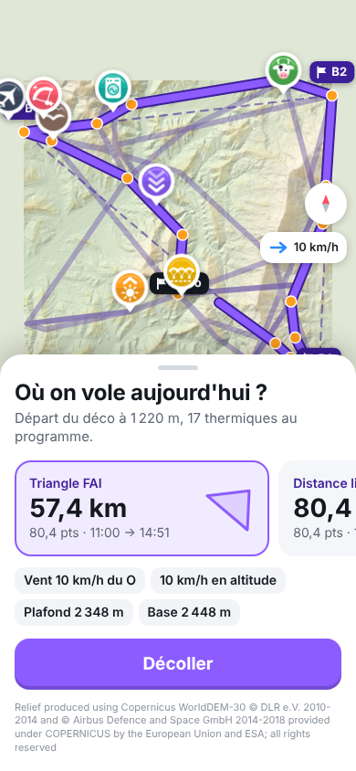
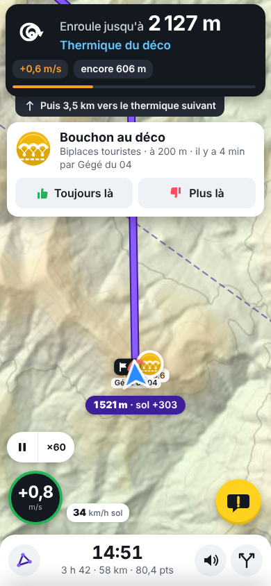
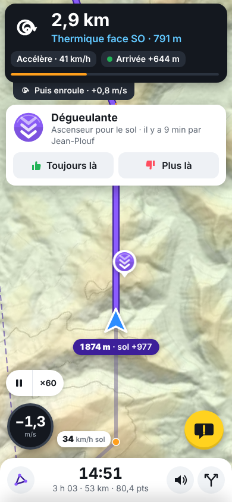
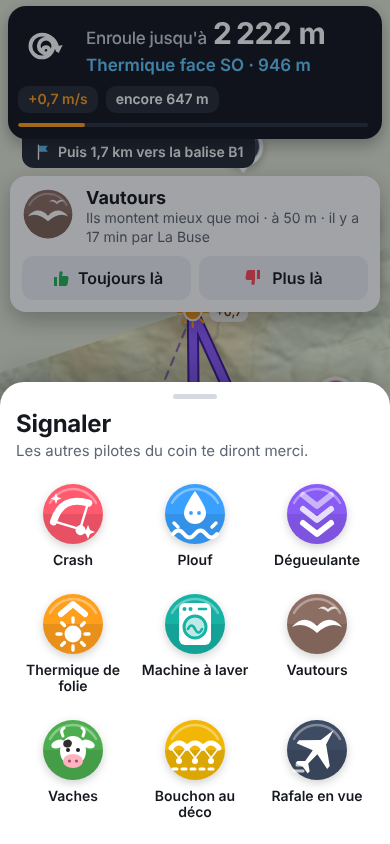
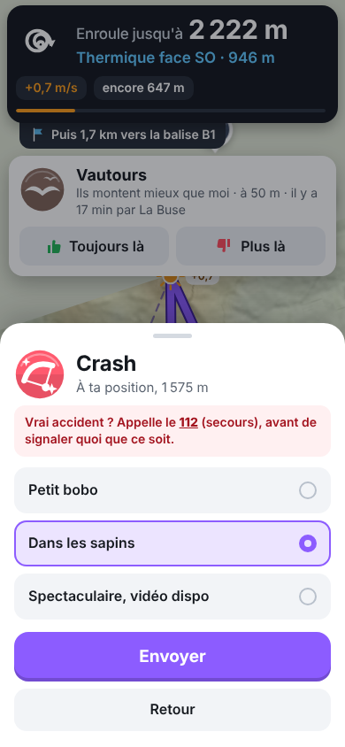
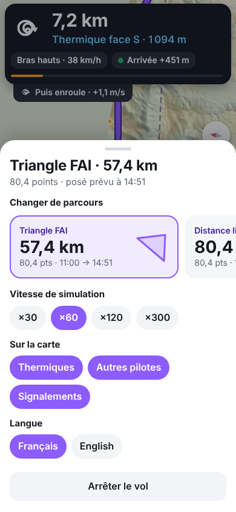
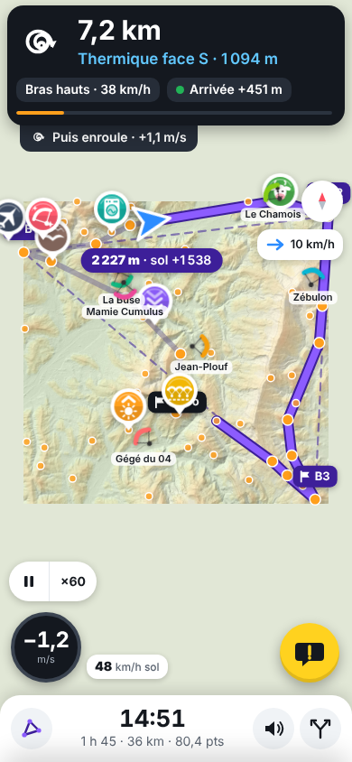
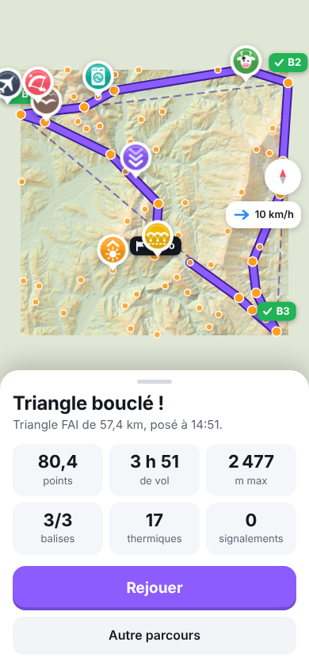

# vautour

**A Waze-style navigation app for paragliding cross-country flights.** vautour reads a flight package computed by
[cheminee](#where-the-data-comes-from) (routes, thermals, timing, speed to fly) and guides the pilot along it on a
phone: manoeuvre banner, distance to the next thermal, airspeed to hold, arrival margin, vario, voice prompts,
and humorous hazard reports shared with the other pilots.

<p>
  
  
  
  
</p>

> **Project status: simulation only.** The app replays the planned route with a flight simulator; it does not
> read the GPS yet, and the routes come from a planner that is not validated on real flights. It is a prototype
> to build on, **not a flight instrument**: never use it to make decisions in the air.

The interface is in **French** by default, with English available from the flight menu (the choice is remembered).
Code, comments and docs are in English.

## Quick start

Node.js 20 or later.

```bash
npm install
npm run dev          # http://localhost:5173
npm run dev:phone    # same, reachable from a phone on the same Wi-Fi (open the "Network" URL)
```

On a desktop browser the app is shown inside a phone frame; on a phone it fills the screen. Add it to the home
screen to get a full-screen app (it ships a web app manifest and icons).

## What it does

- **Route choice**: the routes of the package (FAI and flat triangles, free distance), with distance, points,
  times and the weather of the day.
- **Navigation**: heading-up moving map on the COP30 relief, lift overlay, route line and turnpoints; banner with
  the next manoeuvre (climb to an altitude, glide N km on a heading), speed to fly, arrival margin colour-coded,
  what comes next; vario with sound; ground speed; ETA, remaining time and distance; overview mode.
- **Voice**: segment and approach announcements, hazard warnings (speech synthesis, French or English).
- **Hazard reports** (all humorous, one serious): _Crash, Plouf, Dégueulante, Thermique de folie, Machine à
  laver, Vautours, Vaches, Bouchon au déco, Rafale en vue_, three variants each. Reports ahead of the pilot raise
  an alert that others can confirm ("Toujours là") or clear ("Plus là"). The crash report reminds to call 112
  first.
- **Other pilots** of the demo, flying their own routes.
- **Simulator**: play / pause and ×30 to ×300 time acceleration (jump to any time with the `dt` URL parameter).

<p>
  
  
  
  
</p>

## Scripts

| Command                             | What it does                                                                       |
| ----------------------------------- | ---------------------------------------------------------------------------------- |
| `npm run dev` / `npm run dev:phone` | development server (local / local network)                                         |
| `npm run build`                     | type-check and build the static site into `dist/`                                  |
| `npm run preview`                   | serve `dist/`                                                                      |
| `npm test`                          | unit tests (Vitest), including validation of the sample package against the schema |
| `npm run e2e`                       | end-to-end tests on two phone profiles: Android (Chromium) and iPhone (WebKit)     |
| `npm run lint` / `npm run format`   | Biome lint + format check / fix                                                    |
| `npm run typecheck`                 | TypeScript, strict                                                                 |
| `npm run check`                     | typecheck + lint + unit tests                                                      |
| `npm run screenshots`               | regenerate the README screenshots from a build                                     |

End-to-end tests need the browsers once: `npx playwright install --with-deps chromium webkit`.

### Developer URL parameters

Useful to open the app directly on a given screen:

| Parameter                               | Effect                                                                                                           |
| --------------------------------------- | ---------------------------------------------------------------------------------------------------------------- |
| `?autostart=1`                          | skip the start screen and take off                                                                               |
| `&route=1`                              | pick another route (index in the package)                                                                        |
| `&dt=1.5`                               | jump to 1.5 h after takeoff                                                                                      |
| `&paused=1`                             | start paused                                                                                                     |
| `&sheet=report`, `crash`, `menu`, `end` | open a sheet                                                                                                     |
| `&alert=sink`                           | show the alert of a report kind (`crash`, `plouf`, `sink`, `boom`, `washer`, `vultures`, `cows`, `queue`, `jet`) |
| `&overview=1`                           | overview mode                                                                                                    |
| `?lang=en`                              | English interface                                                                                                |
| `?package=other.json`                   | load another flight package                                                                                      |

## Where the data comes from

The app only reads one file, `public/flight.json`, a **flight package** produced by the sister repository
**cheminee**, the planning engine (Python). The format is versioned and defined by a JSON schema shared by both
repositories (`schema/flight-package.v1.schema.json`). See [docs/flight-package.md](docs/flight-package.md).

The sample package covers about 18 × 18 km around Digne-les-Bains (French Alps) with typical summer weather. The
other pilots and the reports are made up.

## Documentation

- [docs/architecture.md](docs/architecture.md): modules, frame loop, how to add a position source, a report kind
  or a language.
- [docs/flight-package.md](docs/flight-package.md): what the app reads, and how to update the sample.
- [docs/device-testing.md](docs/device-testing.md): what is tested automatically, and the checklist on real
  phones.
- [ROADMAP.md](ROADMAP.md): GPS, re-routing, offline maps, shared reports, native wrapper.
- [CONTRIBUTING.md](CONTRIBUTING.md) and [CLAUDE.md](CLAUDE.md) (notes for AI coding assistants).

## Browser support

Targets **Safari on iOS 16.4+** and **Chrome on Android** (recent versions), plus desktop browsers for
development. Mobile specifics handled: audio and speech unlocked on the first tap (iOS requirement), screen kept
awake during a flight (Screen Wake Lock), safe areas around the notch, dynamic viewport height, page zoom
disabled in favour of map gestures. See [docs/device-testing.md](docs/device-testing.md) for what has really been
tested.

## Deployment

The app is a static site. The `Pages` workflow builds it and publishes it to GitHub Pages on every push to
`main` (enable it once in the repository settings: _Pages → Source: GitHub Actions_). Any static host works:
upload `dist/`.

## Disclaimer

Paragliding is dangerous. This software is an experimental prototype provided "as is", without any warranty,
as stated in the [licence](LICENSE). Its results (routes, thermals, weather, margins, reports) may be wrong. It
is not a flight instrument and must never replace your own judgement, official weather forecasts, airspace
information or flight instruments. You alone are responsible for your decisions; the authors and contributors
accept no liability for any damage, injury or loss arising from its use.

## Licence and credits

Code: [MIT licence](LICENSE): free to use, copy, modify, distribute and sell, including commercially, as
long as the licence notice is kept.

- Relief in the sample package: produced using Copernicus WorldDEM-30 © DLR e.V. 2010-2014 and © Airbus Defence
  and Space GmbH 2014-2018 provided under COPERNICUS by the European Union and ESA; all rights reserved. The app
  shows the notices of `meta.attribution` on its start screen; keep them.
- Weather data, when a package was computed from a forecast: Open-Meteo.com (CC BY 4.0), Météo-France models.
- Font: [Rubik](https://fonts.google.com/specimen/Rubik) (SIL Open Font License), loaded from Google Fonts.
- Icons and illustrations are original drawings made for this project.

Co-authored by Claude (Anthropic).
