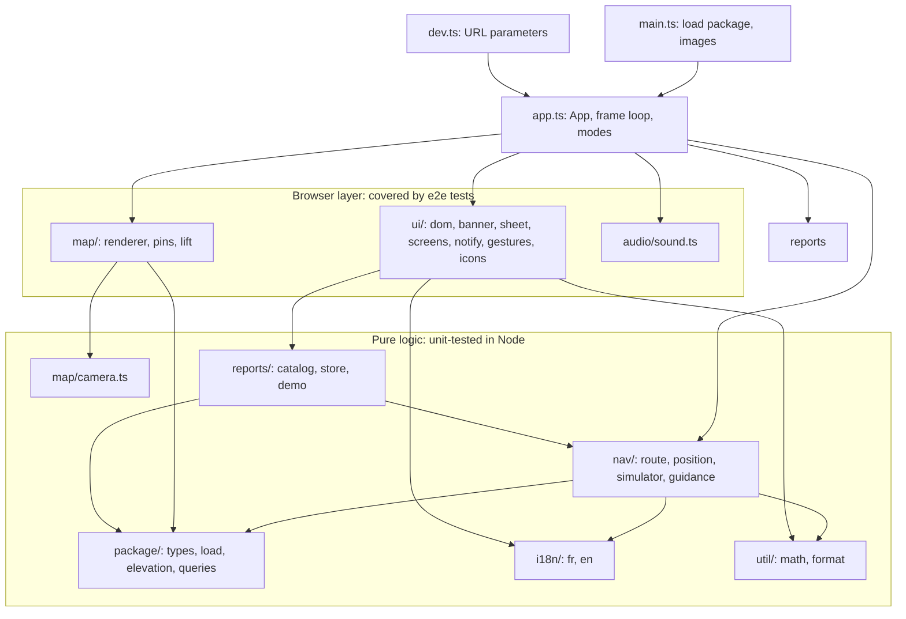

# Architecture

vautour is a static web app: TypeScript (strict), no framework, a Canvas 2D map and a thin DOM layer. Vite builds
it, Vitest tests the logic, Playwright tests the screens on phone profiles, Biome lints and formats.

## Modules

| Folder     | Role                                                                                                                                                                                                                                      |
| ---------- | ----------------------------------------------------------------------------------------------------------------------------------------------------------------------------------------------------------------------------------------- |
| `package/` | The flight package: TypeScript types mirroring the JSON schema, loading and version check, elevation grid decoding, climb-rate and weather lookups                                                                                        |
| `nav/`     | Navigation logic: `prepareRoute` turns a package route into segments with bearings and cumulated distances; `PositionSource` (interface) and `Simulator` (implementation); `guidance` builds the banner instruction and the voice prompts |
| `map/`     | `Camera` (heading-up projection, follow, pan, zoom), `renderer` (terrain, lift overlay, routes, glider, sun), `pins` (DOM markers recycled between frames), `lift` (colour ramp)                                                          |
| `reports/` | Report kinds and icons (`catalog`), `ReportStore` (alerts ahead of the pilot, votes), demo reports and pilots                                                                                                                             |
| `ui/`      | DOM access (`getDom`), banner, bottom sheet, screens (start, report, flight menu, end), toasts and alerts, touch gestures, icons                                                                                                          |
| `audio/`   | `Sound`: Web Audio tones and vario, speech synthesis, unlocked on the first tap                                                                                                                                                           |
| `i18n/`    | UI strings: `fr.ts` (default) and `en.ts`, both typed by `Messages`                                                                                                                                                                       |
| `util/`    | Maths and number / time formatting following the current locale                                                                                                                                                                           |

Rule of thumb: **anything that can be computed without a browser lives in a pure module** and gets a unit test.
DOM modules stay thin: they render what pure modules decide.

## Coordinates

Everything uses the frame of the flight package: x east, y north, in metres, origin at the south-west corner of
the map. Times are decimal local hours (`14.5` = 14:30). The camera turns this into screen pixels:

- `bearing` is the heading shown up on screen (heading-up map); `zoom` is in pixels per metre;
- the glider is anchored at 64 % of the screen height (`GLIDER_Y`) so the pilot sees more of what is ahead;
- `project(x, y)` → screen, `unproject(px, py)` → map; a unit test checks they invert each other.

## Frame loop

`App.start()` runs one `requestAnimationFrame` loop. Each frame:

1. `sim.update(dt)` advances the position source and returns a `NavState` (time, segment, fix, finished);
2. `guide()` announces new segments and approaches, validates turnpoints, renders the banner and raises report
   alerts;
3. the camera follows the glider (unless the pilot panned the map, then "Recentrer" brings it back);
4. HUD (vario, ground speed, ETA), map and pins are drawn.

The terrain image is large: the renderer only draws the sub-rectangle visible on screen, which keeps high zoom
levels fast and avoids browser artefacts with huge scaled images. The lift frames are colourised once at load.
`setHTML` skips DOM writes when the content did not change.

## Modes

`start` (route choice) → `nav` (in flight) → `end` (summary). Sheets (report, flight menu) pause the simulator
while open. The screen is kept awake (Screen Wake Lock) during `nav`.

## Extension points

**A real GPS.** Implement `PositionSource` (`nav/position.ts`) with `kind: "gps"`:

- convert `GeolocationPosition` to the local frame with the package `extent` (linear interpolation between the
  west/east longitudes and south/north latitudes is accurate enough at this scale);
- compute vario and ground speed from successive fixes (or a barometer if a native wrapper exposes one);
- map the fix to the route: the current `segment` is the one whose path is closest ahead of the pilot, and
  `t` comes from the progress along it;
- hold the source in `App` instead of the `Simulator` (today `App.sim` is the simulator; generalise it to a
  `PositionSource` and keep the simulator for demos and tests).

See [ROADMAP.md](../ROADMAP.md) for the re-routing that should come with it.

**A report kind.** Add its key to `REPORT_KINDS` (`reports/catalog.ts`), an icon and a colour there, and its strings
in `i18n/fr.ts` and `i18n/en.ts` (TypeScript refuses to build until both exist, with exactly three variants).
Update the tile count in `e2e/app.spec.ts`.

**A language.** Create `i18n/xx.ts` exporting `const xx: Messages`, list it in `LOCALES` (`i18n/index.ts`) and
name it in `LOCALE_NAMES` (`ui/screens.ts`). The flight menu shows one button per locale.

**A new field of the flight package.** Update cheminee first (schema, export), then copy the schema here, extend
`package/types.ts`, and regenerate `public/flight.json` (see [flight-package.md](flight-package.md)).

## Styles

One stylesheet, `src/styles.css`. CSS variables hold colours and safe-area insets; the layout uses `100dvh` and
`env(safe-area-inset-*)`. On a large screen (`min-width: 561px` and `min-height: 641px`) the app is drawn inside a
phone frame for development and demos. Animations respect `prefers-reduced-motion`.

## Tests

| Kind       | Where                                  | Runs                                                                                                                                                                                                                       |
| ---------- | -------------------------------------- | -------------------------------------------------------------------------------------------------------------------------------------------------------------------------------------------------------------------------- |
| Unit       | `tests/*.test.ts`                      | Node, `npm test`: formatting, maths, i18n completeness, package schema and decoding, route preparation, simulator, guidance, camera, reports, demo                                                                         |
| End-to-end | `e2e/app.spec.ts`                      | Playwright on a Pixel 7 profile (Chromium) and an iPhone 14 profile (WebKit), `npm run e2e`: start, take off, glide banner, crash report, language switch and memory, end screen, layout fits the screen, no console error |
| Manual     | [device-testing.md](device-testing.md) | real phones, before a release                                                                                                                                                                                              |
